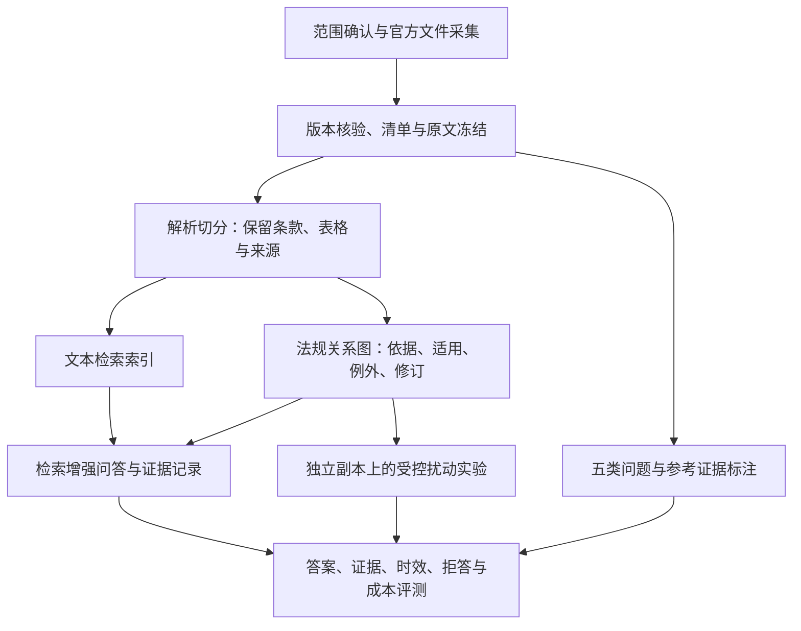

# FinanCRAG Bench

**金融合规场景下的 GraphRAG 证据链、可解释性与鲁棒性评测项目**

FinanCRAG Bench 面向中国境内零售银行公开合规文本，计划构建一套可追溯的法规语料、带证据标注的问答基准和可复现的评测流程。我们希望研究：**模型能否找到正确的法规依据，给出适用条件和版本一致的回答；当证据或图谱受到干扰时，答案与解释是否仍然可信。**

本项目承接“知识增强型大语言模型可解释性”的大创研究背景，以金融合规为具体实验场景。当前执行依据是《E1 执行手册》v1.0（2026-10-24）。本页将手册中的语料、证据关系、五类题及后续实验安排整理为项目概览；下文标为“拟定”的基线和评测维度仍需团队确认，不代表已完成的实验方案。

> **当前进度：E1 准备阶段。** 仓库结构、文档模板和清单校验工具已建立；正式法规清单尚无数据。问答集、图谱、检索系统与投毒实验尚未实现，当前没有性能结果或已发布的数据集。

## 为什么做这个项目

本项目关注的合规问答，需要同时核对“要求是什么”“适用于谁”“有哪些条件或例外”“在指定日期哪一版有效”。因此，我们把回答中的结论、原文依据和跨文件关系作为共同评测对象。

例如，评测题可以描述一项零售贷款业务，要求系统说明适用要求、相关告知义务及其依据。如果题目改变了日期，系统还需要重新判断版本；如果问题超出语料范围，则需要明确说明证据不足。这只是题型示意，具体问题和标准答案必须在官方文件核验后编写。

图检索增强生成（GraphRAG）在本项目中的作用，是把文件、条款及其依据、适用、例外、修订关系组织成可检索的图结构，让回答能够关联到可检查的证据路径。**路径能够展示，并不等于已经证明模型忠实使用了它**；这一点需要通过检索记录、引用核对与受控扰动实验进一步评估。

## 我们要回答的研究问题

| 研究问题 | 拟观察的内容 |
|---|---|
| 图结构在哪些问题上有帮助？ | 对比单跳、多跳、全局、时效与拒答任务中的表现，分析收益是否因题型而异 |
| 答案与证据链是否一致？ | 结论能否由引用条款支持，跨文件路径是否完整，适用条件是否遗漏 |
| 版本与效力信息是否被正确使用？ | 是否引用了错误版本，是否混淆规范文本与解释材料，是否忽略限定条件 |
| 证据受干扰时系统会如何变化？ | 对比干净语料与受控扰动语料上的答案、引用及路径变化 |
| 获得这些能力需要多少成本？ | 在相同实验条件下记录构建、检索与生成的时间和调用开销 |

这些是待验证的问题，不预设 GraphRAG 一定优于文本检索，也不把某条可视化路径当作模型内部推理过程的直接证明。

## 研究范围与数据设计

当前范围草案聚焦全国性、公开可获取的零售银行合规要求：

- **个人贷款与互联网贷款**：业务要求、适用条件及相关配套规定。
- **信用卡与分期**：相关业务要求与文件间适用关系。
- **消费者权益保护**：告知、收费、催收等公开要求。
- **征信与个人信息**：与上述零售银行业务直接相关的规则。

首版不覆盖证券、保险、信托、跨境业务、地方细则、非公开内部制度，以及依赖个案裁量才能作出的结论。范围仍待团队与导师评审；正式边界以 [scope.md](docs/scope.md) 为准。

| 数据层 | 计划内容 | 作用 |
|---|---|---|
| 官方文件 | 总量 15–25 份，其中核心 3–5 部，非核心 10–20 份，至少 2 份历史版本 | 建立可复现的研究语料 |
| 版本与来源元数据 | 官方 URL、文号、发布/生效/失效日期、效力层级、SHA256 | 确认使用了哪份文件、哪一版本 |
| 条款与关系 | 解析目标约 800–2000 条条款，保留原文位置与跨文件关系 | 支撑检索和证据路径检查 |
| 问答与证据标注 | 规划约 200 道题，覆盖五类任务 | 支撑分题型评测与错误分析 |

以上数量是手册中的规划目标，实际规模需在采集与解析后统计。拟定语料基准日为 **2026-10-23**；下载日期另行记录，不能把“今天下载”当作“基准日有效”。

## 五类评测任务

| 题型 | 要考察什么 | 所需证据 |
|---|---|---|
| S1 单跳 | 从一处明确条款回答问题 | 单条要求与原文句 |
| M2/M3 多跳 | 连接多份文件中的依据、适用条件或例外 | 2–3 跳、逐条可核验的关系路径 |
| G 全局 | 汇总同一主题的多项要求 | 同主题至少 3 份文件 |
| T 时效 | 按题目日期选择有效版本 | 新旧文本、施行/废止日期与替代关系 |
| R 拒答 | 识别语料边界或证据不足 | 明确的范围边界及拒答判定依据 |

每道题计划关联答案要点、来源 DOC 编号、条款及必要的关系证据。拒答中的“本语料无足够依据”不能被解释成“法律没有要求”。实际覆盖情况记录在 [覆盖矩阵](docs/coverage_matrix.md)。

## 技术路线与实验设计



**拟定对照方式：**以文本检索增强问答作为基础对照，与图检索、文本与图结合的方案比较。具体框架、模型、参数和预算将在实验方案中确定；当前仓库尚未提供这些系统的运行入口。比较时计划固定语料快照、题集和生成模型，记录检索与上下文预算，避免把模型或数据差异误认为图结构的收益。

**拟定评测维度：**答案正确性、引用支持程度、证据链完整性、版本选择正确性、拒答表现，以及运行成本。指标公式、评分规则、人工复核方式和题集划分仍需确定，再用于正式实验。

**鲁棒性实验：**手册已提出利用历史版本、相似文件和效力层级开展后续投毒研究，并提及依据伪造、版本回滚等场景。实验计划在独立副本中进行，保留干净语料作为对照，记录扰动位置和幅度，观察答案及证据如何变化；原始法规快照不被覆盖。完整攻击分类和实验协议将在后续阶段制定。

## 预期交付物

| 交付物 | 内容 | 当前状态 |
|---|---|---|
| 可追溯法规语料 | 官方原文、18 列清单、版本核验与范围声明 | 模板已建，文件待采集 |
| 条款与法规关系图 | 来源可定位的条款，以及带原文证据的关系 | 未开始 |
| 五类问答基准 | 问题、答案要点、参考条款、关系路径和时间条件 | 未开始 |
| 对照评测与鲁棒性实验 | 配置、运行记录、评分与错误分析 | 未开始 |
| 研究展示与报告 | 证据路径展示、可解释性分析及论文/结题材料 | 计划产出，尚未实现 |

## 当前从哪里开始：E1

E1 的任务是把“研究哪一块、采用哪些文件、文件在基准日是否有效”确定下来，为后续解析、建图、出题和扰动实验提供共同依据。

1. 阅读 [范围声明](docs/scope.md)，团队确认业务边界和时间基准。
2. 按 [候选清单](docs/candidates.md) 和 [搜索关键词](docs/搜索关键词.md) 寻找官方原文。
3. 每份材料建一个 `data/raw/DOCxx/` 目录；核对后写入 [法规清单](docs/manifest.csv)。填写规则见 [数据字典](docs/data_dictionary.md)。
4. 记录文件关系、版本核验和五类题证据，再运行校验。
5. 按 [E1 验收清单](docs/E1_checklist.md) 完成人工复核、导师评审及 [E2 交接](docs/handoff_E1_E2.md)。

## 目录

```text
financrag-bench/
├── README.md
├── CONTRIBUTING.md
├── CHANGELOG.md
├── docs/
│   ├── scope.md                  # 当前范围草案
│   ├── manifest.csv              # 正式数据入口，18 列
│   ├── candidates.md             # 未核验候选，不进入解析
│   ├── data_dictionary.md        # 字段、词表与来源要求
│   ├── relations.csv             # 依据/适用/例外/修订关系证据
│   ├── verification_log.csv      # 版本与来源核验记录
│   ├── coverage_matrix.md       # 五类题的实际证据矩阵
│   ├── E1_checklist.md
│   ├── handoff_E1_E2.md
│   ├── 搜索关键词.md
│   └── templates/               # 手册配套模板
├── data/raw/                    # 每份原文一个 DOCxx 文件夹
├── scripts/                     # 标准库脚本，无第三方依赖
├── tests/                       # 校验器回归检查
└── .github/                     # 自动检查、任务和评审模板
```

## 本地检查（Python 3.10+）

在仓库根目录执行：

```sh
python scripts/validate_manifest.py docs/manifest.csv --mode draft
python -m unittest discover -s tests -v
```

录入文件后，计算其哈希（将路径替换为真实文件）：

```sh
python scripts/hash_file.py data/raw/DOC01/DOC01_简称_类型_版本状态.pdf
```

E1 冻结前必须运行：

```sh
python scripts/validate_manifest.py docs/manifest.csv --mode release
```

`draft` 允许空清单和标注“待核”的元数据，但检查已有文件及哈希；`release` 拒绝空清单、待核状态和不满足数量要求的数据。自动检查不判断法规实际效力，也不能代替导师评审、附件完整性检查或五类题人工验收。

## 阶段进度与协作

| 阶段 | 当前状态 | 完成依据 |
|---|---|---|
| 仓库搭建 | 已准备 | 文件、模板、脚本与本地检查 |
| E1 范围确认 | 草案 | 团队确认及评审记录 |
| E1 法规采集 | 未开始 | 15–25 份官方文件及可追溯元数据 |
| E1 版本冻结 | 未完成 | 自动检查、人工验收、`E1-v1.0` 标签 |
| E2 解析切分 | 未开始 | 从 manifest 读取原文，保留条款与来源 |
| E3 建图 | 未开始 | 效力、版本及关系证据进入图结构 |
| E5 出题 | 未开始 | 五类题及参考证据标注 |
| E9 投毒实验 | 未开始 | 独立副本、干净对照及扰动记录 |

阶段编号沿用 E1 手册已明确提到的编号；手册未给出的阶段定义不在此补造。E1 完成需同时满足自动校验、人工抽查、五类题覆盖设计和评审记录要求，之后才创建 `E1-v1.0` 冻结标签。

本项目使用团队已创建的 [GitHub 仓库](https://github.com/HELLO-Cassio/financrag-bench)，沿用其现有可见性设置。团队协作和冻结流程见 [CONTRIBUTING.md](CONTRIBUTING.md)。本项目尚未选定开源许可证；官方法规和第三方材料的权利归属不因入库而改变。研究基准不提供个案法律意见。
